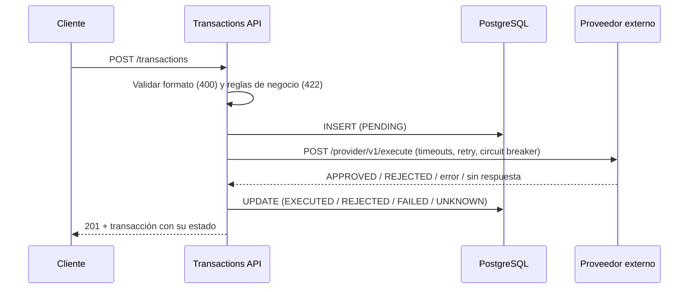

# Transaction Execution API

API REST que recibe transacciones financieras (CREDIT / DEBIT), aplica reglas de negocio, las ejecuta contra un proveedor externo, persiste el resultado y expone una consulta con filtros y paginación.

**Stack:** Java 21 · Spring Boot 4 · Spring MVC con virtual threads · PostgreSQL 17 + Flyway · RestClient + Resilience4j · JUnit 5, Mockito, WireMock y Testcontainers · Docker.

---

## Levantar el proyecto

**Requisito:** Docker con Docker Compose.

```bash
docker compose up --build -d
docker compose ps        # esperar a que "app" esté healthy (~20 s)
```

| Servicio | URL |
|---|---|
| API | http://localhost:8080 |
| Health | http://localhost:8080/actuator/health |
| Proveedor simulado (WireMock) | http://localhost:8089 |
| PostgreSQL | localhost:5432 (usuario, contraseña y BD: `transactions`) |

Para detener todo y borrar los datos: `docker compose down -v`.

### Probar los escenarios

El proveedor simulado decide la respuesta según el `accountId`, así que cada caso se reproduce sin tocar código:

| `accountId` | Respuesta del proveedor | Estado resultante |
|---|---|---|
| cualquier otro | 200 `APPROVED` | `EXECUTED` |
| `acc-insufficient` | 422 `REJECTED` | `REJECTED` |
| `acc-down` | 503 sin cuerpo | `UNKNOWN` |
| `acc-slow` | 200 después de 5 s | `UNKNOWN` (timeout de 3 s) |

```bash
# Transacción aprobada
curl -s -X POST localhost:8080/transactions -H 'Content-Type: application/json' \
  -d '{"accountId":"acc-123456","type":"CREDIT","amount":1500.00,"currency":"MXN","description":"Transferencia recibida"}'

# Rechazada por el proveedor
curl -s -X POST localhost:8080/transactions -H 'Content-Type: application/json' \
  -d '{"accountId":"acc-insufficient","type":"DEBIT","amount":100.00,"currency":"MXN"}'

# Regla de negocio violada (DEBIT mayor a 10,000) → 422
curl -s -X POST localhost:8080/transactions -H 'Content-Type: application/json' \
  -d '{"accountId":"acc-123456","type":"DEBIT","amount":20000.00,"currency":"MXN"}'

# Idempotencia: ejecutar dos veces devuelve la misma transacción
curl -s -X POST localhost:8080/transactions -H 'Content-Type: application/json' \
  -H 'Idempotency-Key: pago-001' \
  -d '{"accountId":"acc-123456","type":"DEBIT","amount":250.00,"currency":"MXN"}'

# Consulta con filtros y paginación
curl -s 'localhost:8080/transactions?accountId=acc-123456&status=EXECUTED&page=0&limit=10'
```

---

## Desarrollo local y tests

**Requisitos:** Java 21 y Docker (los tests de integración usan Testcontainers).

```bash
# Solo infraestructura; la app se corre desde el IDE o con Maven
docker compose up -d postgres provider-mock
./mvnw spring-boot:run

# Todos los tests
./mvnw test
```

| Nivel | Clase | Docker | Cubre |
|---|---|---|---|
| Unitario | `TransactionRulesTest`, `TransactionTest` | No | Reglas de negocio en sus límites y ciclo de vida de la entidad |
| Unitario | `TransactionServiceTest` | No | Orquestación, idempotencia y carrera de duplicados (con mocks) |
| Componente | `HttpTransactionProviderTest` | No | Cliente HTTP: contrato, rechazos, timeouts, reintentos y circuit breaker (WireMock) |
| Slice web | `TransactionControllerTest` | No | Contrato HTTP y traducción de errores |
| Integración | `TransactionIntegrationTest` | Sí | Flujo completo contra PostgreSQL real, incluida la concurrencia con la misma llave |

---

## API

### `POST /transactions`

```json
{
  "accountId": "acc-123456",
  "type": "CREDIT",
  "amount": 1500.00,
  "currency": "MXN",
  "description": "Transferencia recibida"
}
```

Header opcional `Idempotency-Key` (máximo 100 caracteres): si el cliente reintenta con la misma llave y los mismos datos, recibe la transacción original sin volver a ejecutarla.

Respuesta `201 Created`:

```json
{
  "id": "0193f0c2-6a1e-7c3b-9f1a-2b4c5d6e7f80",
  "accountId": "acc-123456",
  "type": "CREDIT",
  "amount": 1500.00,
  "currency": "MXN",
  "description": "Transferencia recibida",
  "status": "EXECUTED",
  "providerTransactionId": "txn-789",
  "balanceAfter": 5500.00,
  "createdAt": "2026-10-27T15:30:00Z"
}
```

Si el proveedor rechaza o falla, la respuesta incluye `failureCode` y `failureMessage`. Los campos nulos se omiten.

### `GET /transactions`

| Parámetro | Descripción | Default |
|---|---|---|
| `accountId` | Filtra por cuenta | – |
| `status` | `PENDING`, `EXECUTED`, `REJECTED`, `FAILED`, `UNKNOWN` | – |
| `type` | `CREDIT`, `DEBIT` | – |
| `page` | Página, empieza en 0 | `0` |
| `limit` | Tamaño de página, máximo 100 | `20` |

Resultados de la más reciente a la más antigua:

```json
{ "content": [ ... ], "page": 0, "limit": 20, "totalElements": 3, "totalPages": 1 }
```

### Errores

Todos los errores siguen [RFC 9457 (Problem Details)](https://www.rfc-editor.org/rfc/rfc9457), con un `code` estable en inglés para clientes programáticos y un `detail` en español para personas:

```json
{
  "type": "about:blank",
  "title": "Regla de negocio no cumplida",
  "status": 422,
  "detail": "Las transacciones DEBIT no pueden exceder 10,000.00 por operación",
  "code": "DEBIT_LIMIT_EXCEEDED"
}
```

| HTTP | Cuándo | `code` |
|---|---|---|
| 201 | La transacción se procesó, **cualquiera que sea su estado** | – |
| 400 | Formato inválido: campo faltante, JSON mal formado, enum inexistente, más de 2 decimales, `limit` > 100 | `INVALID_REQUEST` |
| 409 | `Idempotency-Key` reutilizada con datos distintos | `IDEMPOTENCY_KEY_REUSED` |
| 422 | Regla de negocio violada | `AMOUNT_BELOW_MINIMUM`, `DEBIT_LIMIT_EXCEEDED`, `UNSUPPORTED_CURRENCY` |
| 500 | Error inesperado (el detalle solo queda en el log) | `INTERNAL_ERROR` |

Un rechazo del proveedor responde **201 con `status: REJECTED`**: la transacción sí se creó y quedó registrada. El 422 se reserva para las reglas que se validan antes de llamar al proveedor.

---

## Estados de una transacción

| Estado | Significado | ¿Se ejecutó en el proveedor? |
|---|---|---|
| `PENDING` | Registrada; esperando respuesta del proveedor | En curso |
| `EXECUTED` | El proveedor aprobó | Sí |
| `REJECTED` | El proveedor rechazó (p. ej. fondos insuficientes) | No |
| `FAILED` | No se pudo contactar al proveedor o el circuito estaba abierto | No, con certeza |
| `UNKNOWN` | Timeout o 5xx sin respuesta válida | **No se sabe**: requiere conciliación |

Distinguir `FAILED` de `UNKNOWN` es la decisión central del servicio: solo lo primero es seguro de reintentar. Ver [ADR-0004](docs/adr/0004-modelo-de-estados-y-resultado-incierto.md).

---

## Arquitectura



```
src/main/java/mx/gilortiz/transactions/
├── transaction/              Dominio y caso de uso. No depende de HTTP.
│   ├── TransactionController, TransactionService, TransactionRepository
│   ├── Transaction (entidad), TransactionRules, TransactionFilter
│   ├── TransactionProvider   ← interfaz hacia el proveedor (puerto)
│   ├── ProviderResult        ← resultado sellado: Approved | Rejected | Failed | Unknown
│   └── dto/
├── provider/http/            Implementación HTTP del proveedor (RestClient + Resilience4j)
└── common/web/               Manejo global de errores y formato de paginación
```

Capas clásicas (controller → service → repository) organizadas por funcionalidad. La inversión de dependencias se aplica donde aporta: el servicio depende de la interfaz `TransactionProvider`, y la implementación HTTP vive en `provider/http`. Fuera de ese paquete nada sabe que el proveedor se llama por HTTP.

---

## Decisiones de diseño

Cada decisión relevante está documentada como ADR en [`docs/adr`](docs/adr):

| ADR | Decisión |
|---|---|
| [0001](docs/adr/0001-arquitectura-en-capas-con-inversion-de-dependencias.md) | Capas por funcionalidad con inversión de dependencias solo hacia el proveedor |
| [0002](docs/adr/0002-spring-mvc-con-virtual-threads.md) | Spring MVC + virtual threads en lugar de WebFlux |
| [0003](docs/adr/0003-postgresql-y-modelo-de-datos.md) | PostgreSQL, modelo de datos, índices y paginación |
| [0004](docs/adr/0004-modelo-de-estados-y-resultado-incierto.md) | Estados PENDING / UNKNOWN y llamada al proveedor fuera de la transacción de BD |
| [0005](docs/adr/0005-resiliencia-ante-el-proveedor.md) | Timeouts, reintentos solo en fallas de conexión y circuit breaker |
| [0006](docs/adr/0006-idempotencia.md) | Idempotencia con `Idempotency-Key` y constraint único |
| [0007](docs/adr/0007-contrato-de-errores.md) | Códigos HTTP y errores con ProblemDetail |

### Por qué PostgreSQL

- **Transacciones ACID y constraints:** el `UNIQUE` de la llave de idempotencia y los `CHECK` de montos y estados protegen la integridad aunque falle el código.
- **`NUMERIC` exacto** para dinero.
- **Índices compuestos** para las consultas por cuenta y por estado con alto volumen de escritura.
- Es parte del stack de Spin, y Testcontainers permite probar contra la misma versión que en producción.

Una base en memoria no sobrevive a reinicios, y una documental no ofrece constraints únicos transaccionales tan directos para la idempotencia. Detalle en [ADR-0003](docs/adr/0003-postgresql-y-modelo-de-datos.md).

### Escalabilidad (millones de transacciones al día)

- **Virtual threads:** miles de requests concurrentes esperando al proveedor sin agotar threads del sistema operativo.
- **El pool de conexiones (20) es la contrapresión** que protege a PostgreSQL, y **ninguna conexión se retiene durante la llamada HTTP**.
- **Circuit breaker:** con el proveedor caído se responde en microsegundos en lugar de acumular requests esperando el timeout.
- **UUID v7** como llave primaria: ordenado por tiempo, los inserts no fragmentan el índice.
- **Solo dos índices secundarios**, alineados a las consultas reales.
- **Servicio sin estado:** escala horizontalmente; la idempotencia se garantiza en la base de datos, no en memoria.

---

## Limitaciones y siguientes pasos

- **Conciliación:** las transacciones `UNKNOWN` y las `PENDING` antiguas deben resolverse consultando al proveedor. Requiere un endpoint de consulta del proveedor que el contrato actual no tiene; hoy quedan identificadas e indexadas por estado.
- **Reintentos seguros de timeouts:** solo serían posibles si el proveedor aceptara una llave de idempotencia.
- **Paginación keyset** (`WHERE (created_at, id) < (...)`) para páginas profundas; el `COUNT(*)` y el `OFFSET` se degradan con millones de filas. Se mantuvo `page`/`limit` porque es el contrato pedido.
- **Eventos:** publicar el resultado de cada transacción (outbox + Kafka) para otros servicios.
- **Observabilidad:** métricas del circuit breaker y del cliente HTTP con Micrometer, trazas distribuidas y logs estructurados.
- **Seguridad:** autenticación (OAuth2/JWT) y autorización por cuenta; fuera del alcance del reto.
- **Configuración del circuit breaker** externalizada en `application.yaml`.

---

## Uso de IA

<!-- Ajusta esta sección con tus palabras: debe describir exactamente cómo trabajaste. -->

Usé **Claude (Anthropic)** como asistente durante todo el reto, en modalidad de *pair programming*:

- **Diseño:** discutí con Claude el enfoque antes de escribir código (arquitectura, modelo de estados, estrategia de reintentos, idempotencia). Las decisiones finales fueron mías; por ejemplo, elegí capas clásicas en lugar de hexagonal, Maven, incluir `Idempotency-Key`, mensajes en español con códigos en inglés y el nombre de los paquetes.
- **Código:** Claude propuso el código paso a paso; lo escribí manualmente archivo por archivo, lo revisé y lo ajusté hasta entender cada línea.
- **Depuración:** resolví con su ayuda problemas de configuración (importación de Maven en el IDE, validación de esquema de Flyway e Hibernate) y errores que detectaron los tests (beans sin anotar).
- **Documentación:** Claude redactó el borrador de este README y de los ADRs; los revisé y adapté.

Puedo explicar cada decisión y cada línea del código entregado.
